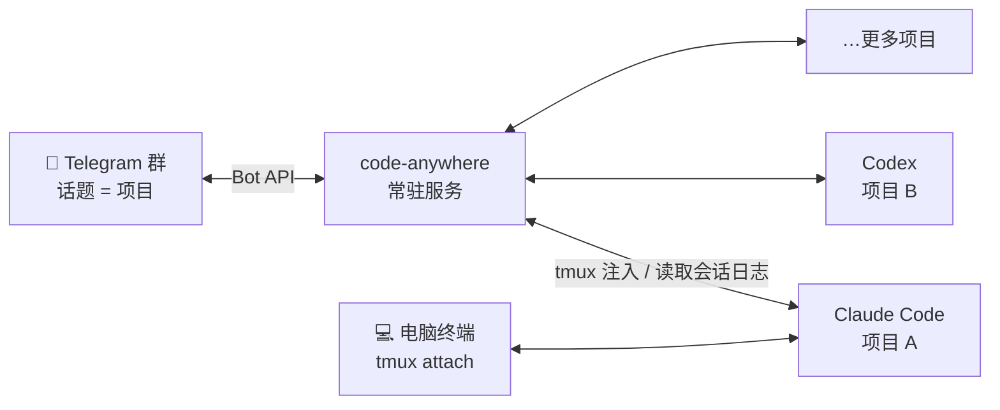
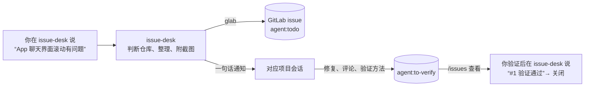

# Code Anywhere

**在手机 Telegram 里，远程驱动你服务器上的 Claude Code 和 Codex。**

每个项目对应 Telegram 群里的一个话题。你在话题里说话，消息会被送进服务器上那个项目的 CLI 会话；CLI 的回复、工具调用、截图、权限审批，会实时回到同一个话题。电脑上的终端和手机上的 TG 用的是**同一个会话**，随时切换，不丢上下文。



## 快速开始

需要：一台 Linux 或 macOS 机器（可以是 SSH 进去的服务器）和一个 Telegram 账号。其余依赖（Python、tmux、Node、Claude Code、Codex……）`./setup` 都会自动安装。

```sh
git clone git@github.com:gowcar/code-anywhere.git ~/workspace/code-anywhere
cd ~/workspace/code-anywhere
./setup
```

`./setup` 是交互式的，按提示一步步来，大约 10 分钟：

1. **装依赖**：Python、tmux、Node、Claude Code、Codex、glab，缺什么自动装什么；`./setup --yes` 全部默认同意。
2. **建 bot**：在 Telegram 找 [@BotFather](https://t.me/BotFather) → `/newbot`，把 token 粘贴给 setup，它会立刻验证。
3. **建群**：新建群 → 开启「话题 / Topics」→ 把 bot 设为管理员（勾选“管理话题”）→ 在群里随便发一句话。setup 收到后**自动识别群 ID 和你的账号**，只允许你本人使用。
4. **其余全自动**：Claude hooks、会话通信 MCP、全局规则、开机自启的常驻服务，最后往群里发一条“✅ 已就绪”。

`./setup` 可以反复执行：已经好的步骤直接跳过，只修缺的。`./setup --check` 只检查不改动。详见 [docs/PROVISIONING.md](docs/PROVISIONING.md)。

## 日常怎么用

**开始一个项目**：在群里发 `/new 项目名`（默认 Claude，`/new 项目名 codex` 用 Codex），立刻出现同名话题，进去直接说话。已有的目录也可以：在服务器上进入目录运行一次 `claude` 或 `codex` 说句话，5 分钟内自动出现话题。

**在话题里**：

| 你做的事 | 效果 |
|---|---|
| 直接发文字 | 送进该项目的 CLI 会话，回复实时推回来 |
| 发截图、文件 | 存到项目的 `.attachments/`，CLI 直接能看 |
| 发视频 | 只保存到 `.attachments/videos/`（上限 20MB），不发给模型，回复保存路径 |
| Claude 要执行需审批的操作 | 话题里弹出审批按钮，点一下允许 / 拒绝 |
| CLI 向你提问（单选、多选、表单） | 以 TG 按钮菜单呈现，点选即可 |
| CLI 生成或查看了图片 | 自动上传到话题 |

**命令**：

| 命令 | 作用 |
|---|---|
| `/new 名字` | 在服务器上建项目目录 + 话题并启动 CLI，全程不用登录服务器 |
| `/abort` | 中断正在跑的回合，并丢弃已发出但还没处理的排队消息（会把丢弃的原文回给你） |
| `/model` | 查看当前模型；`/model list` 列出全部；`/model claude sonnet high full` 一句切换引擎、模型、effort、权限，历史不丢 |
| `/permissions` | Codex 权限：`full` / `workspace` / `read-only` |
| `/status` | 所有会话的活动状态（进行中、空闲、失败） |
| `/issues` | GitLab issue 按状态汇总，待验证的附验证方法；每条带按钮：✅ 通过 / ↩️ 不通过 / 🗑 放弃（见下文） |
| `/projects` `/sessions` | 项目列表、历史会话 |
| `/trust` `/whoami` | 项目信任开关、你的 TG ID |

**在电脑上**：`t` 打开 tmux 会话选择器，进入任意项目的会话，和手机上看到的是同一个。

## 它为什么稳

作者日常重度使用了几个月，下面这些都是踩过坑后的设计：

- **服务挂了会自己起来**：systemd / launchd 常驻，开机自启，异常退出 5 秒内重启。
- **重启不丢消息**：每个会话转发到哪里都记在磁盘上，服务重启后从断点补发。
- **只认真实的 CLI 会话**：按 tmux 进程和会话日志定位，不会把消息投错项目。
- **新目录首次启动不吞消息**：自动处理 Claude / Codex 的“信任此目录”确认框。
- **一眼看出在不在干活**：话题名前的 🟢（干活）🟡（等你）🔴（重试或疑似卡住）；干活时底部有一张状态卡，转圈、用时、token、最近 4 个动作实时滚动，自带 [⏹ 中断] [📸 看终端] 按钮；5 分钟没有真实进展会主动提醒。
- **失败看得见**：Codex 的模型限流、网关报错等失败会推到话题里，不会默默卡住。
- **防失忆**：每个项目自动维护 `recon/PROGRESS.md`，会话压缩或重开后先读它接续进度。

## 进阶

### 会话之间互相协作

内置 `local-sessions` MCP（Claude 和 Codex 都已注册），让一个项目的 Agent 能给另一个项目的 Agent 派活、查进度。约定：消息只写一句话，复杂内容放进 md 文件、消息里给路径。详见 [docs/session-mcp.md](docs/session-mcp.md)。

### 用 GitLab issue 管理反馈

`./setup` 可选配置 GitLab。之后会多一个 **issue-desk** 话题：



- issue-desk 维护一张**别名路由表**（“App”→ iOS 仓库，“服务端”→ 后端仓库……），在 `~/workspace/issue-desk/CLAUDE.md` 里随时改。
- 状态：`agent:todo` → `agent:doing` → `agent:to-verify` → 你验证后关闭；`agent:blocked` 表示需要你决定。
- 在 TG 发 `/issues` 就能处理：点 **✅ 通过** 直接关闭；点 **↩️ 不通过** 退回待处理，并可直接回复原因（会写进 issue、通知负责会话）；不想做了点 **🗑 放弃**（二次确认）。负责会话按项目的 git 远端自动找到。
- 截图会上传到 GitLab，同时在本机留原件，项目会话用 `issue-images <仓库> <编号>` 直接取。

## 常见问题

- **一个 bot 能给两台机器用吗？** 不能，同一时间只能被一台机器接收。换机器就新建 bot，或先停掉旧机器的服务。
- **服务怎么重启 / 看日志？** `systemctl --user restart code-anywhere`，日志在 `logs/code-anywhere.log`。不要用 `./code-anywhere.sh start`，会起第二个实例抢消息。
- **换了 Node 版本后 CLI 起不来？** 重跑 `./setup`，它会按新位置重写服务的 PATH。

## 开发

```sh
.venv/bin/python -m unittest discover -s tests -q
```

代码结构：`src/bot.py`（TG 入口与命令）、`src/api_server.py`（会话日志监听与转发）、`src/backends.py`（Claude / Codex 启动与识别）、`hooks/`（Claude hooks）、`provision/`（安装程序）、`tools/`（`t`、`tmux-tui` 等个人工具）。项目进度与设计决策见 `recon/PROGRESS.md`。
